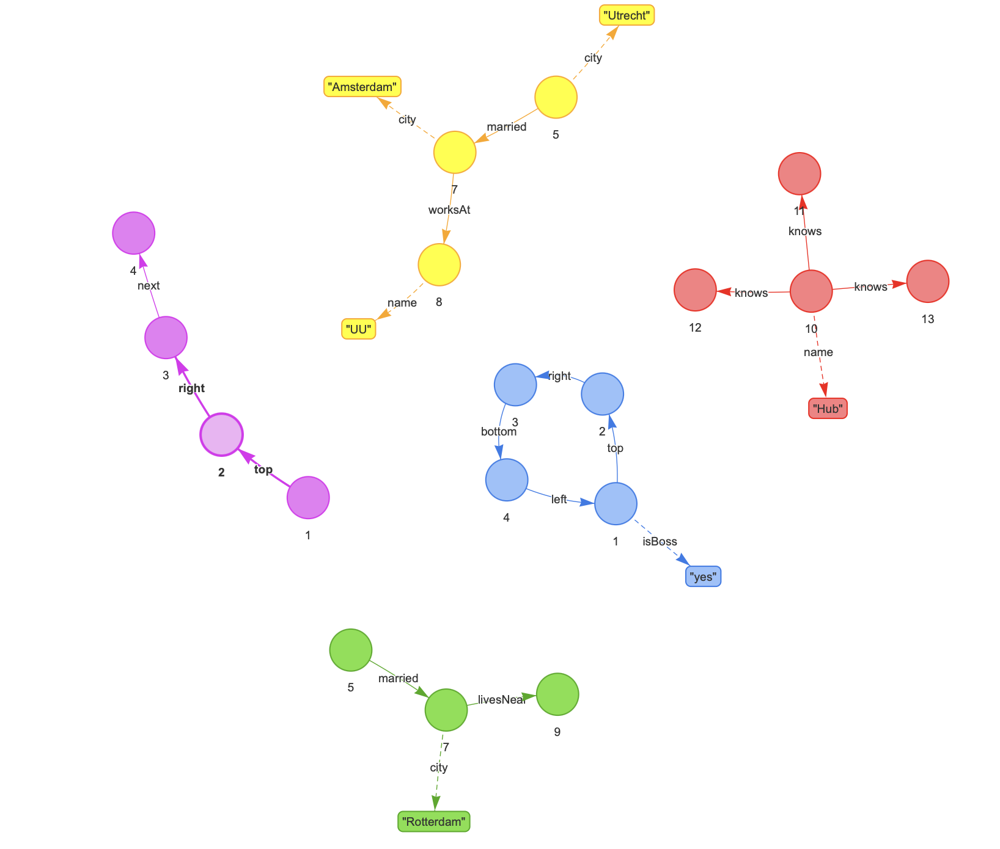

## DIS project on graph database reduction




### Makefile command shortcuts
```bash
make visualise              # makes graphs.html
make visualise GRAPH=2      # only graph 2 in graph2.html

make install                # installs the project with uv
make clean                  # removes the generated html graphs
```