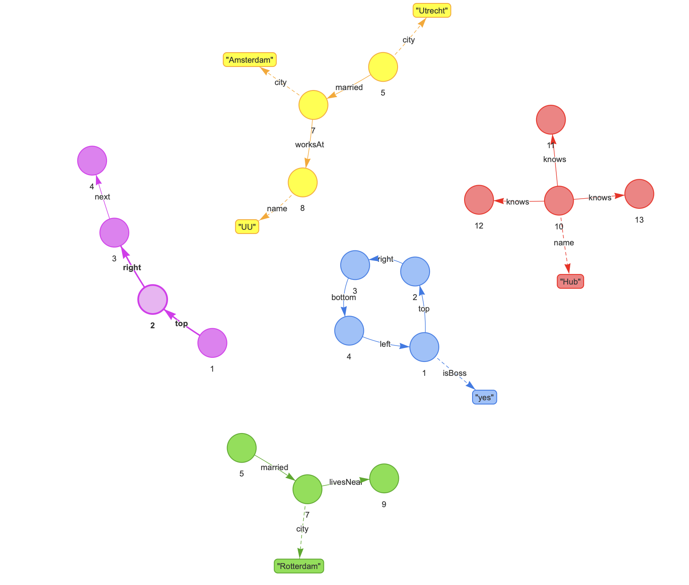

## DIS project on graph database reduction
### Run the reduction

From the project root, run a reduction with:

```bash
python3 main.py --graph data/DatabaseX_1.txt --qlog data/QLog1_1.txt \
  --query_coverage full --graph_selection simple --importance_threshold 0.9
```

`--graph` and `--qlog` are paths relative to the project root. The query-log filename must follow the
`QLog<database number>_<log number>.txt` pattern; `main.py` uses those numbers in the output filename.
The reduced database is written to `data/reductions/`.

Arguments:

| Argument | Default | Description |
|---|---|---|
| `--graph` | `data/DatabaseX_1.txt` | Input graph database. |
| `--qlog` | `data/QLog1_1.txt` | Query log used to select graphs. Its lines are split in half: the first half guides selection, and the second half is reserved for evaluation. |
| `--query_coverage` | `full` | How query coverage contributes to graph importance: `full` scores fully answered queries; `partial` includes partial path coverage; `distributed` shares each fully answered query's score among the graphs answering it. |
| `--graph_selection` | `simple` | `simple` ranks graphs once by importance; `rounds` greedily selects one graph at a time, recalculating its gain. |
| `--importance_threshold` | `0.9` | Fraction of the input graphs to keep, from 0 to 1. |
| `--graph_similarity` | `False` | Enable an information-gain-based selection step to account for graph similarity. |
| `--similarity_budget` | `0.2` | Fraction of the selected-graph budget reserved for information-gain selection when graph similarity is enabled. |
| `--tests` | `False` | Evaluate the reduced database against the second half of the input query log and other available logs for that database. |
| `--performance` | `False` | Print timing and database-size statistics. |

For the boolean options, pass `True` to enable them, or omit them to leave them disabled. Do not pass
`False`: the current argument parser treats any supplied value, including the string `False`, as true.



Big IMDb database: [images/imdb_big](images/imdb_big/README.md)

### Dataset versions (`make datasets`)
| File | Graphs | Max edges | Semantic |
|---|---|---|---|
| `data/DatabaseX_1.txt` | 20 | 10 | low |
| `data/DatabaseX_2.txt` | 20 | 10 | high |
| `data/DatabaseX_3.txt` | 20 | 50 | low |
| `data/DatabaseX_4.txt` | 20 | 50 | high |
| `data/DatabaseX_5.txt` | 1000 | 10 | low |
| `data/DatabaseX_6.txt` | 1000 | 10 | high |
| `data/DatabaseX_7.txt` | 1000 | 50 | low |
| `data/DatabaseX_8.txt` | 1000 | 50 | high (= `imdb_big.txt`) |

IMDb lists ~10 main people per movie, so low-semantic graphs never have more than 16 edges.

Images of each version: [images/datasets](images/datasets/README.md)

### Makefile command shortcuts
```bash
make visualise              # makes graphs.html
make visualise GRAPH=2      # only graph 2 in graph2.html
make visualise DATABASE=data/imdb_big.txt GRAPH="0 1" HEIGHT=1600px   # graphs 0 and 1 in graphs0-1.html
make imdb-images            # images of the big IMDb database
make datasets               # the 8 dataset versions (+ filtered QLogs if data/QLogX.txt exists)
make dataset-images         # images of the 8 dataset versions

make install                # installs the project with uv
make clean                  # removes the generated html graphs
make toy-example            # runs the reduction on the toy restaurant dataset
```

### Setup

The reduction uses PySpark. Install Java 21 separately, then select it before
running Spark commands:
```bash
brew install uv
brew install openjdk@21
export JAVA_HOME="$(brew --prefix openjdk@21)/libexec/openjdk.jdk/Contents/Home"
export PATH="$JAVA_HOME/bin:$PATH"
java -version                # should report Java 21
make install                 # installs Python dependencies with uv
```

`make install` 

### Reduce Function Metric

To test the query coverage of a DB (after a Reduce), run:
```
uv run python src/QLog_satisfaction.py <DB_path> <QLog_path>
```

### Examples

Step-by-step scripts in `examples/`, from the simplest reduction to the full one
(run from anywhere; they change to the project root and use `uv`):
```bash
./examples/01_naive_full_coverage.sh           # sort once by fully answered queries
./examples/02_naive_partial_coverage.sh        # + partly answered queries count
./examples/03_naive_distributed_coverage.sh    # + a query's point is split over its answering graphs
./examples/04_greedy_rounds.sh                 # greedy: one graph per round, gains recomputed
./examples/05_greedy_with_graph_similarity.sh  # + graph similarity
./examples/06_graph_similarity_budget_tradeoff.sh
./examples/07_large_keep_with_timings.sh
```
They use `data/DatabaseX_7.txt` with `data/QLog7_2.txt`, keeping 2% of the graphs; change this with `GRAPH`, `QLOG` and `KEEP`, e.g. `QLOG=data/QLog7_4.txt ./examples/04_greedy_rounds.sh`.

### Plots

All plot scripts are in `plotting/`. To make every plot (about 30 minutes, most of it the 192 comparison runs):
```bash
./plotting/run-all-plots.sh
```
or one part of it:
```bash
./plotting/query-log-charts.sh    # how often each query is asked, one chart per query log type
./plotting/measure-charts.sh      # score of every graph under full, partial and distributed, side by side
./plotting/compare-methods.sh     # all methods on databases 5-8 × 4 query logs × B = 1, 2, 5, 10% (192 runs, progress bar)
./plotting/compare-small-databases.sh     # all methods on the small databases 1-4 × 4 query logs × B = 20, 40% (96 runs)
./plotting/compare-similarity-budgets.sh  # greedy + graph similarity budgets 0.1, 0.5, 1.0 on databases 5-8 × B = 1, 2% (96 runs; after compare-methods.sh)
./plotting/baseline-comparison.sh         # all methods on the baseline dataset (peer-dataset-test/Dataset24_fixed/) × B = 1, 2, 5, 10% (13 runs)
```

Every run of `main.py` saves its plots in `plots/runs/<run settings>/`, one folder per phase:

| Folder | Plot | Shows |
|---|---|---|
| `1_match/` | `coverage_table.png` | share of each past query a graph satisfies (1 = full answer), ×n = times asked |
| `2_scores/` | `graph_scores.png` | the highest importance scores under the chosen measure, kept graphs with their pick order |
| `3_selection/` | `answered_queries.png` | which past queries the kept graphs still answer, weighted by times asked |
| `3_selection/` | `kept_graphs.png` | one square per graph of the database: kept or dropped, answers a query or not |
| `4_evaluation/` | `coverage.png` | exact coverage and closeness on the past, the future and the other logs, against a random reduction (with `--tests True`) |

Every plot is drawn from a CSV saved next to it (the run also writes `run_info.json`, `queries.csv` and `timings.json`), so after changing how a plot looks you can redraw everything without running anything again:
```bash
uv run python -m plotting.replot                     # or: --only runs comparison measures q_logs
```
Plots across runs:

| Folder | Made by | Shows |
|---|---|---|
| `plots/q_logs/` | `plotting/query-log-charts.sh` | how often each query is asked, one chart per query log type |
| `plots/measures/` | `plotting/measure-charts.sh` | full, partial and distributed scores side by side |
| `plots/comparison/small_databases/` | `plotting/compare-small-databases.sh` | the same comparison for databases 1-4 with B = 20, 40% (`keep_<B>/`, `keep_curve.png`, `results.csv`) |
| `plots/comparison/similarity_budget/` | `plotting/compare-similarity-budgets.sh` | past and future coverage against the graph similarity budget (`similarity_budget.png`, `results.csv`) |
| `plots/baseline/` | `plotting/baseline-comparison.sh` | the methods on the baseline dataset per B (`comparison.png`, `timings.png`, `query_log.png` and their CSVs) |
| `plots/comparison/` | `plotting/compare-methods.sh` | per B and database: methods × query logs (`keep_<B>/`), `keep_curve.png`, `timings.png`, and the data in `results.csv` and `timings.csv` |
| `report_figures/` | `uv run python -m plotting.report_figures` | the report's plots, drawn at their printed size from the CSVs above (the diagram crops come from Lucid) |
