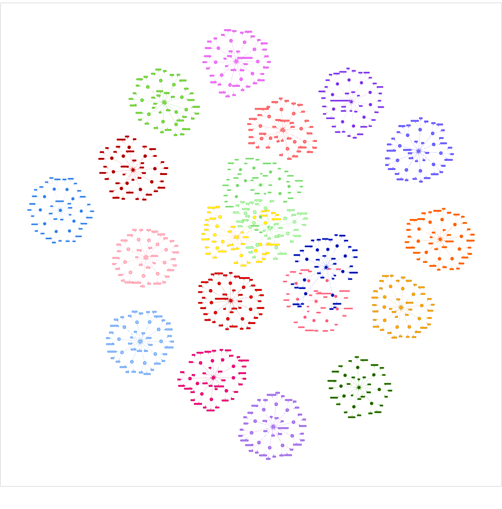
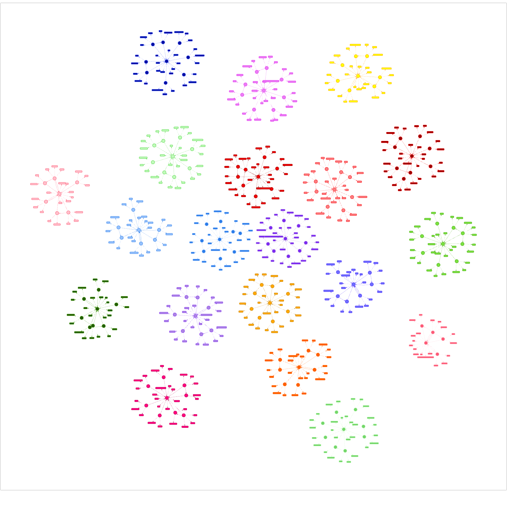
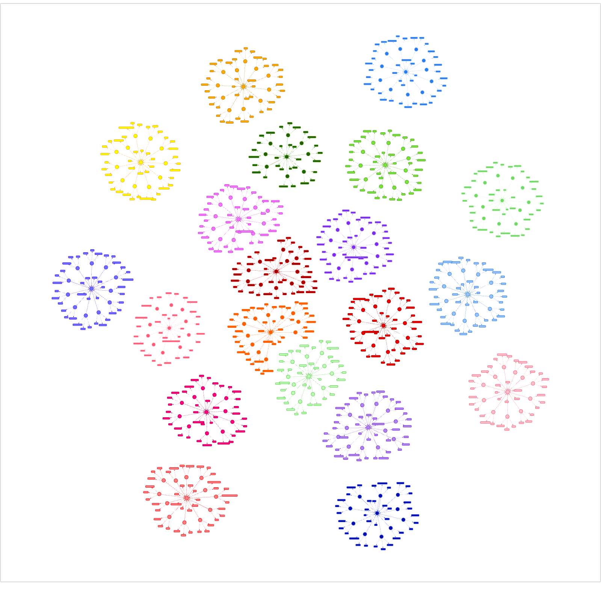
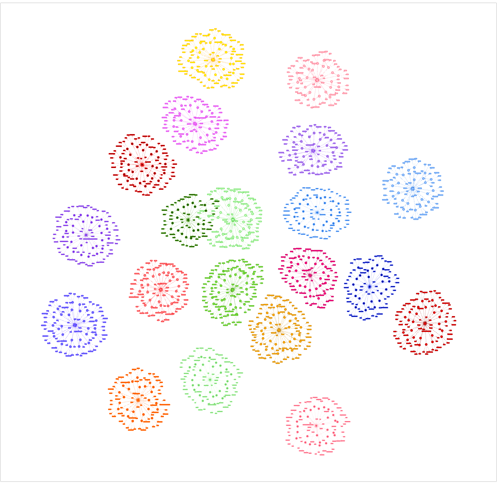
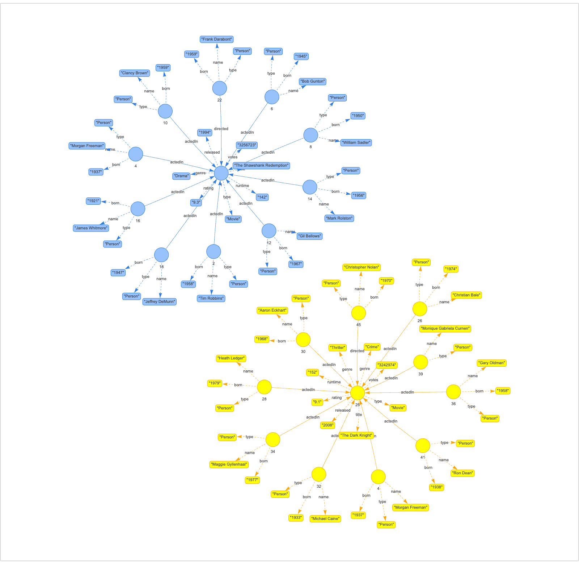
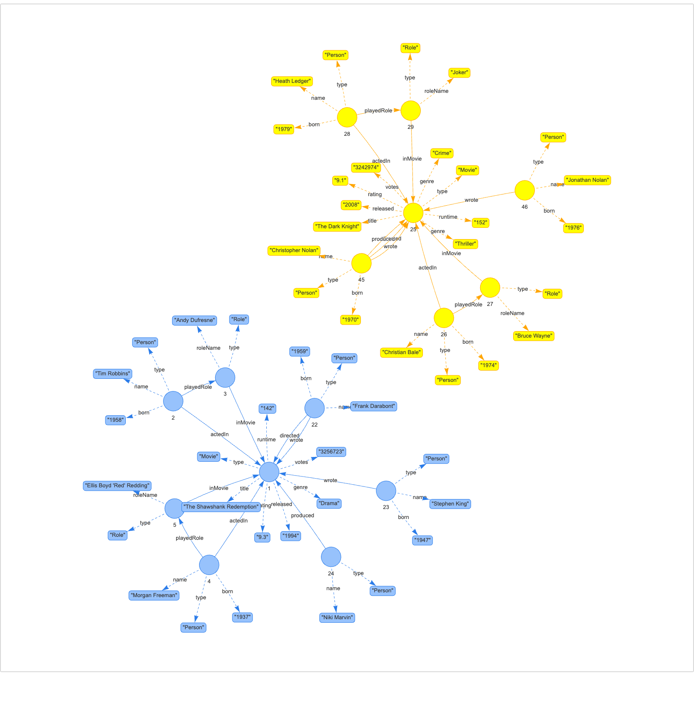
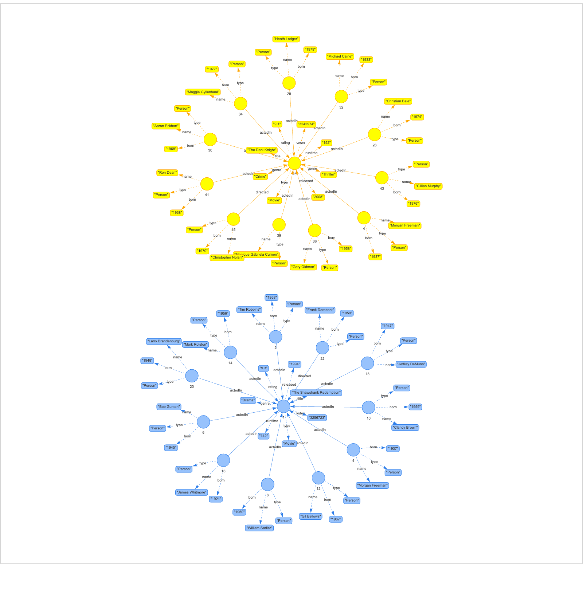
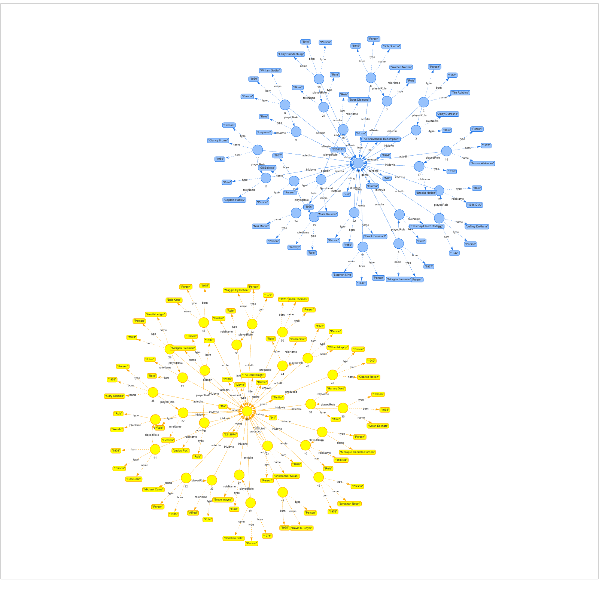

## Dataset versions

Versions 1–4 show all 20 graphs; versions 5–8 show only graphs 0 and 1
(The Shawshank Redemption and The Dark Knight), the same two movies in each.
Interactive versions (open in a browser): [html/datasets](../../html/datasets)

| | Low semantic | High semantic |
|---|---|---|
| **20 graphs, max 10 edges** |  `DatabaseX_1` |  `DatabaseX_2` |
| **20 graphs, max 50 edges** |  `DatabaseX_3` |  `DatabaseX_4` |
| **1000 graphs, max 10 edges** |  `DatabaseX_5` |  `DatabaseX_6` |
| **1000 graphs, max 50 edges** |  `DatabaseX_7` |  `DatabaseX_8` |

```bash
make dataset-images    # regenerate these images and html (needs Chrome)
```
