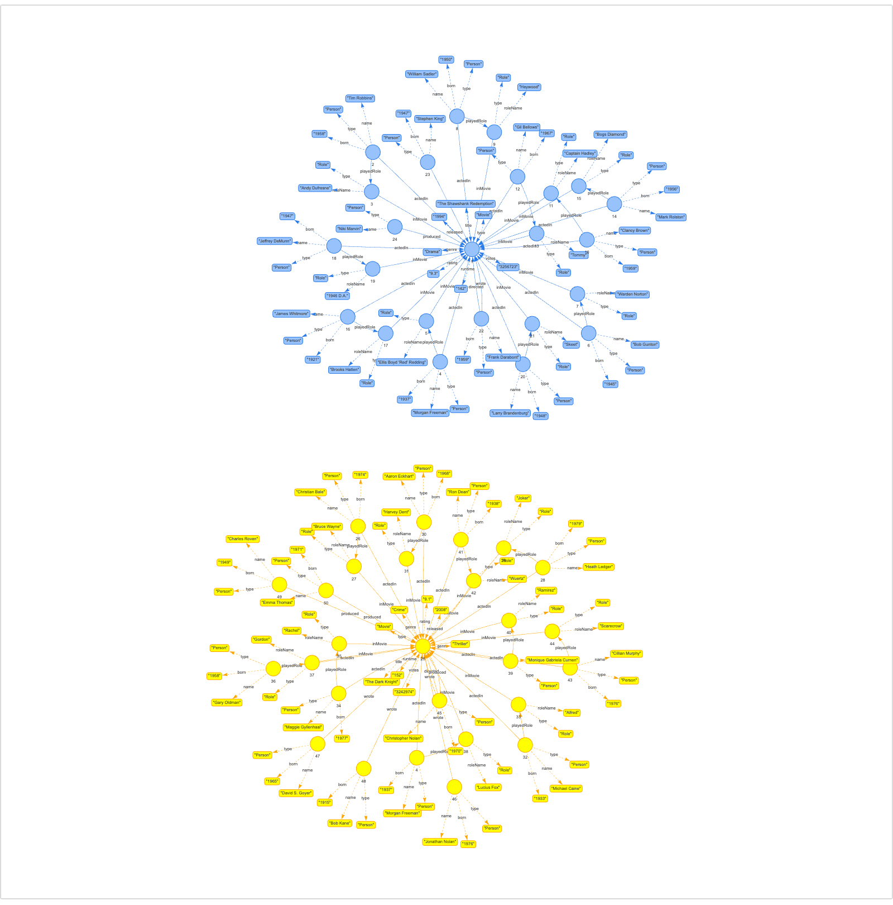

## IMDb big database

`data/imdb_big.txt`: 1000 graphs, one movie each, at most 50 edges per graph.

### Two movies (graphs 0 and 1)


### Whole database (edges only)


```bash
make imdb-raw       # download the IMDb files
make imdb           # generate data/imdb_big.txt
make imdb-images    # regenerate these images (needs Chrome)
```
